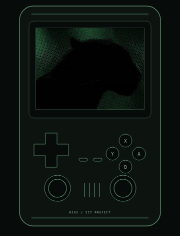

# 227 AI — offline AI for the R36S

**227 AI** turns the **R36S** handheld into a private, fully offline
AI assistant. It runs a small language model **entirely on the device** — no
internet, no cloud, no accounts. Ask questions with the on-screen keyboard,
dictate with a USB microphone, and hear the replies read aloud.

This repository contains the app, artwork, licenses and a **graphical deployment
manager** for installing, updating and removing 227 AI. The app gets a **227**
system page in EmulationStation so you launch it like a game.

[](https://github.com/1Z99/project-ai-r36s/releases/download/v1.0.0/227-ai-demo.mp4)

**[Download the installer: install227ai.sh](https://github.com/1Z99/project-ai-r36s/releases/download/v1.0.0/install227ai.sh)**
 · **[Full walkthrough with sound](https://github.com/1Z99/project-ai-r36s/releases/download/v1.0.0/227-ai-demo.mp4)**

The animation uses the same R36S artwork and native UI demo as the local project
site: opening animation, typing, replies, read-aloud, microphone test, dictation
and history. Replies and microphone input are scripted PC demonstrations, not a
live model or a device recording. Click it for the full video with offline-generated
speech. GitHub READMEs cannot run the site's interactive video player; the GIF is
a silent preview.

---

## Highlights

- **100% offline** — the model runs locally via `llama.cpp`. Nothing leaves the
  device.
- **Graphical manager** — controller-driven install, update / repair and uninstall
  with explicit SD card selection and resumable downloads.
- **Chat with a real keyboard** — a full on-screen keyboard with word
  suggestions.
- **Read aloud** — offline text-to-speech with word-by-word highlighting.
- **Dictation** — offline speech-to-text with `whisper.cpp` (USB microphone).
- **Settings on the device** — change model, system prompt, generation options,
  speech rate and background from the app (press **R2**).
- **Your microphone, your choice** — pick the audio device in **R2 → VOICE**
  and check it with the built-in **TEST MICROPHONE**. The choice is remembered
  across card renumbering. There is no separate MIC TEST application.
- **Dictate into the system prompt** — the system-prompt keyboard has its own
  **MIC** key, so the prompt can be written by voice too.
- **Chat history** — keep and reopen recent conversations.
- **No cloud dependency at runtime** — the app talks only to its local inference
  server at `127.0.0.1:39227`; internet access is needed for installation downloads.

---

## Requirements

- An **R36S** running **dArkOSRE** (aarch64), or a compatible
  aarch64 ArkOS-style image with EmulationStation.
- A writable, actually mounted **main SD card** (`/roms`) or **second SD card**
  (`/roms2`). Both are detected independently of EmulationStation's ROM layout;
  the graphical manager always requires you to select a destination explicitly.
- Allow about **650 MiB free** on a fresh app destination for downloads and
  staging, or about **25 MiB** of additional staging space when the installed
  runtime and both models verify. These are budgets, not exact install sizes.
  Preflight also credits retained partial downloads. Cache occupies card space
  until uninstall; system packages need separate space on the system partition.
- The manager needs Python **3.9+**, `curl`, `libSDL2` and `libSDL2_ttf`.
  The bootstrap can set up missing capabilities on supported firmware as
  described below. An existing broken or too-old Python fails without upgrading.
- The app additionally needs `libespeak-ng.so.1` with usable English voice data,
  ALSA `arecord`, `aplay` and `amixer`, and `pkill` (procps). Regular and bold
  DejaVu Sans Mono fonts are bundled on the SD card, not a manual OS-font requirement.
- Internet access for downloads unless all required files are supplied locally.
  The installed app needs no network connection. Optional `dialog` can keep a
  bootstrap failure visible when a usable console is available.

---

## Install

### Easy Install (No Commands Needed)

1. **Copy the installer to your SD card.** On your computer, download
   **[install227ai.sh](https://github.com/1Z99/project-ai-r36s/releases/download/v1.0.0/install227ai.sh)**.
   Turn off the handheld, put the SD card you use for games into your computer,
   and copy the downloaded file into its **`tools`** folder (alongside the game
   folders, not inside one). Safely eject the card and put it back in the handheld.
2. **Connect to Wi-Fi, install, then restart.** Turn on the handheld and connect
   it to Wi-Fi. In the game menu, open **Tools** and select **install227ai**
   (it may be shown as **install227ai.sh**). On the installer screen, use the
   D-Pad and **A** to select the card you want to install on: **Main SD / SD1**
   or **Second SD / SD2**. Choose **INSTALL**, confirm **Yes**, and wait for
   success. Only then restart the handheld. Open **227 > 227 AI** to start chatting.

Keep the handheld powered while it installs. Wi-Fi is needed for the downloads;
once installed, 227 AI works offline. You do not need SSH or terminal commands
for this method. If you cannot see the card's game folders or `tools` folder on
your computer, do not format the card; use the SSH method below instead.

### Advanced Install (SSH)

Use this method if you already have SSH enabled on the handheld and want to
download the installer without removing the SD card. Connect from a terminal
on your computer, replacing the placeholders with your handheld's username
and IP address:

```sh
ssh YOUR_USER@YOUR_HANDHELD_IP
```

Run the following commands in that SSH session. For the **main card / SD1**,
use `/roms/tools` as shown. For the **second card / SD2**, use `/roms2/tools`
in both command blocks. Use the card's existing `tools` folder.

```sh
cd /roms/tools && \
curl -fL --connect-timeout 15 --max-time 120 -o install227ai.sh.download \
  https://github.com/1Z99/project-ai-r36s/releases/download/v1.0.0/install227ai.sh && \
mv install227ai.sh.download install227ai.sh && less install227ai.sh
```

Stop if a command fails; do not run an older file after a failed download.
After a successful download, read the script in the viewer and press **q**
to close it. If `less` is unavailable, open the downloaded file in a text editor
before continuing. Then start the installer:

```sh
sh /roms/tools/install227ai.sh
```

The installer opens on the **handheld's screen**, not in your SSH terminal.
Use the D-Pad and **A** to choose **Main SD / SD1** or **Second SD / SD2**,
choose **INSTALL**, confirm **Yes**, and wait for success. Only then restart
the handheld and open **227 > 227 AI**. The install card you choose on screen
can be different from the card holding the downloaded file.

### Installer Details and Maintenance

The bootstrap still fetches current application source from `main`; the
`v1.0.0` asset page hosts the runtime and installer downloads, not a frozen
copy of the current app. Use
`install227ai.sh` for all downloads. The stored manager uses `install.bootstrap`
internally so EmulationStation does not list its support folder as another tool.
Use **Tools > Install 227 AI**; nothing inside `227-ai-manager/` needs opening.
Running this updated download also replaces an older manager's shortcut before
removing its legacy internal `install.sh`. Restart EmulationStation to clear
the old folder entry. Existing cached managers do not update themselves; app
Update / Repair alone does not perform this migration.

The bootstrap fetches four matching manager modules (UI, core, CLI and
`installer_deps.py`) into `<card>/tools/227-ai-manager/`, validates them in
temporary files, then publishes
them with atomic per-file renames. If any module is missing, including the new
helper, it refreshes the whole four-module set rather than mixing old and new
modules. A complete stored set is reused. Downloads have finite connection, low-speed
and overall timeouts. It prefers the Tools card it was launched from; otherwise
it uses a writable mounted `/roms2`, then `/roms`. **This only chooses manager
storage, never the app destination.** The manager stays on that Tools card even
when you install or remove the app on the other card.

Reopen **Tools > Install 227 AI** for maintenance. The self-locating launcher
runs the stored manager directly, without an SSH session or terminal chooser.
The bootstrap sets `SDL_VIDEODRIVER=kmsdrm` and `SDL_RENDER_DRIVER=software` on
the handheld; `--desktop` leaves the desktop's SDL environment unchanged.

### Automatic dependency setup

Before Python starts, the shell checks installed Python 3.9+ and `curl`. If
either tool is absent, it can install only the missing tools and their approved
dependencies. It never replaces an existing broken or older Python. Before the
graphical manager opens its SDL display, `installer_deps.py` checks the manager's
SDL libraries and `curl`. After an explicitly confirmed install/update, the core
checks all app dependencies too: eSpeak's library and English data, ALSA tools
and procps. Package names include `libespeak-ng1`, `espeak-ng-data`, `alsa-utils`
and `procps`. Working capabilities cause **no APT/package-database queries and
no system changes**; the check is not a general firmware upgrade.

Only missing capabilities trigger OS/architecture and privilege checks. Automatic
setup requires Debian/Ubuntu-family firmware, `aarch64`, dpkg architecture
`arm64`, APT, and root or noninteractive `sudo -n`. No password is requested or
stored. Unsupported systems or missing administrator access produce a clear
error and missing-package list; this does not promise installation on every
Linux image or firmware.

APT first simulates a plan with
`--no-upgrade --no-remove --no-install-recommends`.
The entire dependency closure is version-pinned and
simulated again before installation. Upgrades, removals and protected graphics
or firmware packages, including Mesa/EGL/GLES/GBM/DRM/Mali, are rejected. Package
indexes are refreshed only if the initial simulation fails. Broken existing
libraries are errors, not permission to replace the graphics stack.

SHA-256-validated regular/bold fonts and their existing DejaVu license are kept
in the manager's `fonts/` directory. The manager and app use bundled fonts without
requiring OS fonts; app fonts live in its data root, with OS fonts as fallback.
`--desktop`, help, dry-run and uninstall skip automatic dependency setup.
System packages live outside the app-file rollback and SD staging budget, are
shared with the OS, and are **kept on uninstall**.

### Progress and failures

Progress is **per file / task**, with actual transferred bytes, transfer rate,
elapsed time and file ETA where known. Unknown lengths are indeterminate; there
is no invented overall download percentage. Failures stay on screen: **A**
retries/resumes, **X** opens error details, and **B** returns to the menu.
**B** during work offers a cancellation confirmation; downloaded partials remain.
Once APT installation, final publication or removal starts, cancellation waits
until that operation finishes safely. Do not power off during system setup or
finalization. Failed app-file updates restore replaced files; installed system
dependencies are not rolled back. A failed rollback reports retained backup locations.

Manager events/errors are saved in `227-ai-manager/installer.log`; bootstrap
downloads and UI startup errors go to `227-ai-manager/bootstrap.log`. A bootstrap
failure tries `dialog --msgbox` when installed. If SDL cannot start and no usable
console exists, no persistent graphical error display is possible: inspect the
log over SSH, fix the dependency/network problem, and relaunch. No TTY read is
used to hold the launcher open. Before manager storage is available, errors can
only go to stderr / an available dialog.

### Headless CLI

CLI mode is explicit; graphical mode does not accept `--roms` or action flags.
Every CLI change requires both an explicit card and `--yes`:

```sh
sh install227ai.sh --help            # no SDL, network or writes
sh install227ai.sh --cli --roms /roms2 --action install --yes
sh install227ai.sh --cli --roms /roms2 --action update --yes
sh install227ai.sh --cli --roms /roms2 --action uninstall --yes
sh install227ai.sh --cli --roms /roms2 --action install --dry-run
```

Dry-run discovers both cards and validates the selected target without creating
logs, locks, caches, bytecode or manager files. It requires an existing
`installer_core.py` beside the bootstrap or in `installer/`; a standalone fresh
bootstrap deliberately refuses to download anything for dry-run. It does not
test downloads or estimate required staging space. CLI-only `--es-cfg PATH` and
`--themes PATH` allow isolated tests; changes are logged in `installer-cli.log`.

### Local builds

From a checkout, `sh install227ai.sh` uses `installer/` without downloading manager
modules and automatically passes the checkout root as `--source` when `app/`
exists. This tests **unpushed app/assets/system changes**, not the published
copies. Use `sh install227ai.sh --desktop` for a PC window, or `--source PATH` to
select another release tree. Local logs live in `installer/`.

A self-contained manager build can place `install227ai.sh` and the four Python
modules together, with a release tree at `bundle/` beside them. The UI and CLI
automatically use `bundle/` when present. Include app, assets, licenses and system
folders; put the runtime archive plus its pinned `.sha256` sidecar and both model
files at the bundle root for fully local installation. Missing binaries still
need downloads; an incomplete local app bundle fails instead of mixing sources.

Development overrides remain supported:

- `PROJECT_AI_RAW_BASE`: raw repository base for manager modules and remote
  app/assets/licenses/system files. Supports `file://` fixtures.
- `PROJECT_AI_REL_BASE`: release asset base for runtime, checksum and model mirrors.
- `PROJECT_AI_RUNTIME_LOCAL`: local runtime archive; its adjacent `.sha256` is
  required and must match the backend's pinned checksum.

For an isolated headless source test, create the target and an ES config first:

```sh
mkdir -p /tmp/227-test/card /tmp/227-test/themes
printf '<systemList></systemList>\n' > /tmp/227-test/es_systems.cfg
sh install227ai.sh --cli --roms /tmp/227-test/card --action install --dry-run \
  --es-cfg /tmp/227-test/es_systems.cfg --themes /tmp/227-test/themes
# Replace --dry-run with --yes to actually install the local source build.
```

---

## What the installer does

`$R` is the explicitly selected app destination (`/roms` or `/roms2`). `$T` is
the independent Tools card where the bootstrap keeps the manager.

| Path | Contents |
| --- | --- |
| `$R/tools/project_ai_r36s.py` | The application |
| `$R/tools/project_ai_settings.py` | Settings panel module |
| `$T/tools/Install 227 AI.sh` | Self-locating manager launcher |
| `$T/tools/227-ai-manager/` | Bootstrap, four Python manager modules, `fonts/`, optional bundle and logs |
| `$R/227ai/227 AI.sh` | EmulationStation launcher (the "ROM") |
| `$R/227ai/gamelist.xml` + `227-art.jpg` | System listing and cover art |
| `$R/tools/project_ai/runtime/` | `llama.cpp` server + libraries |
| `$R/tools/project_ai/whisper/whisper-cli` | Speech-to-text engine |
| `$R/tools/project_ai/models/` | LFM 2.5 model + whisper model |
| `$R/tools/project_ai/logo.rgba`, `intro-*.{zip,rgba}`, `words.txt`, `DejaVuSansMono*.ttf` | Interface artwork, word list and bundled regular/bold fonts |
| `$R/tools/project_ai/config.json` | Your settings (created only if missing) |
| `$R/tools/project_ai/licenses/` | Third-party license texts |
| `$R/.227-ai-cache/` | Download cache and temporary staging |
| `/etc/emulationstation/es_systems.cfg` | Only the **227** system registration is added/updated/removed |

The application finds its own folder at run time, so it works on either card.
Your chats (`chats.json`) and history (`history.json`) live in
`$R/tools/project_ai/`. Install and update / repair preserve these and existing
settings, verify reusable models/runtime, and compare managed app/assets/system
files before deciding whether publication is needed.
Uninstall deletes app data on the selected card, including all conversations.
The manager and its Tools entry remain. ES has one shared **227** registration;
installing on another card repoints it there without deleting the other copy.

---

## Using 227 AI

### Main screen

| Button | Action |
| --- | --- |
| **D-Pad Up/Down** | Scroll the conversation |
| **A** | Open the keyboard (or read a highlighted reply aloud) |
| **X** | Chat history |
| **Y** | New chat |
| **B** | Exit |
| **R2** | Open / close Settings |

### On-screen keyboard

| Button | Action |
| --- | --- |
| **D-Pad** | Move between keys |
| **A** | Type the selected key |
| **X** | Send the message |
| **Y** | Insert a space |
| **B** | Delete a character (closes the keyboard when the draft is empty) |
| **Up** (from the top row) | Pick a word suggestion |
| Select the **MIC** key | Start dictation; tap it again to stop |

### History

| Button | Action |
| --- | --- |
| **D-Pad Up/Down** | Move |
| **A** | Open the selected chat |
| **X** / **B** | Close |
| **Y** | Delete the selected chat |

### Settings (press **R2**)

| Button | Action |
| --- | --- |
| **Up/Down** | Switch page (or move between rows when focused on values) |
| **Right** | Focus the value panel |
| **Left/Right** | Change a value |
| **A** | Select / adjust |
| **B** | Close Settings |

Settings pages: **MODELS**, **SYSTEM PROMPT**, **GENERATION**, **VOICE**,
**APPEARANCE**, **SYSTEM INFO**. Changes are saved to `config.json`
immediately. Changing the model or context reloads the engine in place.

---

## Models and storage

227 AI uses the following models (SHA-256 verified by the installer):

| Model | File | Size | Source |
| --- | --- | --- | --- |
| LFM 2.5 350M | `models/LFM2.5-350M-QAD-Q4_0.gguf` | ~209 MB | [LiquidAI/LFM2.5-350M-GGUF](https://huggingface.co/LiquidAI/LFM2.5-350M-GGUF) |
| Whisper tiny.en (q5_1) | `models/whisper/ggml-tiny.en-q5_1.bin` | ~31 MB | [ggerganov/whisper.cpp](https://huggingface.co/ggerganov/whisper.cpp) |

Downloads are attempted from this repository's
[releases](https://github.com/1Z99/project-ai-r36s/releases) first, then Hugging Face, and
are verified against a checksum before use. The model is licensed under the
**LFM Open License v1.0** — see `licenses/LFM2.5-Open-License.txt`.

---

## Update / uninstall

Open **Tools > Install 227 AI**, explicitly select the app's card, then choose
**UPDATE / REPAIR** or **UNINSTALL** and confirm. Update preserves settings and
chats. **Uninstall permanently removes the selected card's app, models, settings,
chat history and cache. Back up `chats.json` / `history.json` first if needed.**

In the default online mode, an install/update resolves GitHub `main` through the
GitHub API, then stages source files from that **immutable commit**. Even an
already-current installation needs internet to check the source. API failures
(including rate limits) and source-fetch failures report an inability to check,
never a cached "up to date" success. Download cache is not proof of source freshness.

The backend returns `up_to_date` and the UI shows **YOU'RE UP TO DATE** only when
all managed source files, actual model/runtime hashes, owned EmulationStation
and theme metadata, required executable permissions and config-file existence
check out. This skips app-file publication, not checking, staging, cache or log
activity. ES play statistics and unrelated metadata are preserved; harmless XML
rewrites do not count as updates. Missing or invalid models/runtime, launchers,
permissions or registration trigger repair. Differing existing payload bytes are
reported as **Updated/repaired files**: without a release baseline, they cannot
reliably distinguish a newer version from corruption. No version baseline is invented.

With `--source` or an automatic local `bundle/`, comparisons use that local tree,
not GitHub; the UI explicitly identifies a local test bundle. App Update / Repair
does **not** update the cached manager. Updating the bootstrap and matching four
manager modules remains a separate manual maintenance task.

For headless removal:

```sh
sh install227ai.sh --cli --roms /roms2 --action uninstall --yes
```

Only the selected card's ES registration is removed; unrelated systems and a
registration pointing at another card are preserved. A legacy whole-config
backup is never restored. The independent manager remains for reinstalling.
Shared system dependencies are retained as well.
Restart EmulationStation after installation or removal to refresh its systems.

---

## Repository layout

```
install227ai.sh                          graphical / CLI bootstrap
installer/installer_ui.py                SDL deployment manager
installer/installer_core.py              shared install / update / uninstall backend
installer/installer_cli.py               explicit headless frontend
installer/installer_deps.py              capability checks and restricted APT setup
app/project_ai_r36s.py                  application (default model: LFM 2.5)
app/project_ai_settings.py              settings panel
assets/                                 logo, intro frames, background, art, fonts
system/227 AI.sh, system/gamelist.xml   EmulationStation system files
licenses/                               third-party license texts
dev/                                    optional PC preview + build tools
```

`.gitignore` belongs in this repository: it excludes generated Python files, logs
and large release binaries from source commits. `PUBLISHING.md` is optional
maintainer documentation for updating release assets; users do not need it to
install or run 227 AI.

## Tested Device

The recorded October 18, 2026 hardware run used an **R36S with Panel 4**
(owner-identified), dArkOSRE build **`03082026`**, Linux **`4.4.189`**, aarch64,
Python **`3.13.5`**, and a 640 x 480 display. Fresh installation, real model/runtime
downloads and checksum checks, update preserving settings/chats, and uninstall
retaining the manager passed on the main-SD exFAT layout (`/roms`).

The historical manager at tested source revision `c83568c` is **1.2.0**; the binary asset
release is **v1.0.0**. Those are separate versions. The **85 automated tests** at
that app revision cover deployment and manager behavior, not model accuracy or
performance. A fresh two-card manager installation and other hardware/firmware
variants are not certified by that single-device run.
The bootstrap and manager report version **1.2.0**. The automatic dependency
setup and content-based update results are newer than that historical hardware
record and test count; they are covered by the current automated suites, not by
that single-device run.

`dev/project_ai_preview.py` renders the interface on a desktop computer for
development (`dev/prepare_intro_frames.py` rebuilds the intro asset).

---

## Release assets

The installer pulls binary files from the repository's **Releases** page:

| Asset | SHA-256 |
| --- | --- |
| `project-ai-r36s-runtime-arm64.tar.gz` | `4ad9f9a9aa29d05370982e3b7bdf53b4b9879893a41a4ffa9e7fd72b39a8c1b2` |
| `LFM2.5-350M-QAD-Q4_0.gguf` (mirror) | `3d10b6ab8fc91a919534b9558e266255aca0bbc7f6d015963599aa9e74e05b1d` |
| `ggml-tiny.en-q5_1.bin` (mirror) | `c77c5766f1cef09b6b7d47f21b546cbddd4157886b3b5d6d4f709e91e66c7c2b` |

The runtime is `llama.cpp` (`0.7.0-dev`, build `11669`, commit `620d2225c`,
aarch64) plus `whisper.cpp`'s `whisper-cli`, both MIT-licensed.

---

## Troubleshooting

- **Missing dependency / no voice** — the installer checks eSpeak's library
  and English data during confirmed install/update. Inspect the missing-package
  list and setup error; automatic setup needs supported APT firmware and root
  or `sudo -n`.
- **Cannot verify GitHub main** — check internet access and the error details,
  including API rate limits, then retry. A cached download cannot prove that the
  app is current. A local-bundle check only verifies against that local bundle.
- **No microphone** — dictation needs a **USB** microphone; the internal mic on
  the R36S is not usable. Check `arecord` / `aplay` and R2 > VOICE > TEST MICROPHONE.
- **The "227" system does not appear** — restart EmulationStation or reboot.
  Confirm `es_systems.cfg` contains `<name>227</name>`; select the correct card
  and run **UPDATE / REPAIR** to register it if missing.
- **Download fails** — check Wi-Fi, then press **A** to retry or relaunch the
  manager. App downloads resume; model downloads try the release mirror, then
  Hugging Face. See `installer.log` / `bootstrap.log` for errors.
- **First reply is slow** — the model loads into RAM on the first request; later
  replies are quicker. Settings shows engine state on the main screen.

---

## Credits and license

Created by **1Z99**. Application and artwork are **MIT** licensed (see
[`LICENSE`](LICENSE)). Bundled/used third-party projects — `llama.cpp`,
`whisper.cpp`, **LFM 2.5**, Whisper, SDL2, espeak-ng and DejaVu fonts — keep
their own licenses; see [`CREDITS.md`](CREDITS.md) and the
[`licenses/`](licenses) directory.
